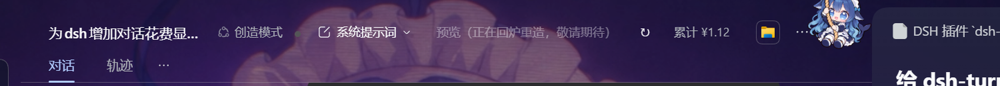

# dsh-turn-cost

给 [DeepSeek Harness](https://github.com/deepseek-ai/deepseek-harness) 的 Web 界面加两个小字：每条回复底部显示**这一轮**花了多少钱，顶部标题栏显示**本次会话**累计花了多少钱。

```
   ⧉   👍  👎   ¥0.031   ⤴     📊 用量 61.8K tok   11月4日 16:38
```


```
测试信息精简回复  标准模式 ·  系统提示词 ⌄   预览（…）   ↺   累计 ¥0.031
```



金额就长在原来的动作行里，紧挨着「用量 61.8K tok」；顶部的「累计」是整场会话的总账。鼠标悬停显示明细：输入 / 缓存命中 / 输出 token、命中哪一档单价、高峰还是空闲。

## 它是怎么算的

DeepSeek 的计费规则就是「token 数 × 模型单价」，所以这里的金额就是实际扣减的钱（赠送金/充值金只决定从哪个钱包扣，不影响金额）。

插件不猜、不估：Conversation 层已经把每一轮从 `turn/start` 到 `turn/end` 的每次请求按 `assistant/message` 上报的用量折叠成精确的四个桶——

| 桶 | 含义 | 计费方式 |
| --- | --- | --- |
| `cacheReadTokens` | 缓存命中的输入 | × 缓存命中单价 |
| `uncachedInputTokens` | 缓存未命中的输入 | × 缓存未命中单价 |
| `cacheWriteTokens` | 写缓存的输入 | 按未命中单价计（保守） |
| `outputTokens` | 输出 | × 输出单价 |

只要有一处对不上（attempt 生命周期不完整、总量自相矛盾），官方折叠就会放弃这一轮的用量，插件也什么都不显示——宁可不显示，也不给错数。

## 顶部「累计」怎么来

会话累计取自 token-meter 的会话级投影 `tokenUsage`（就是输入框下面 `24.4M tok` 那个数背后的同一份统计），它实时包含正在进行中的这一轮。

总额不是「总 token × 一个价」，而是：

1. 已经结束的轮次：逐轮取 `turn-tail.tokenUsage`，**按该轮结束时刻**判断高峰/空闲后分别计价再相加；
2. 剩下的部分（= 会话累计 − 已完成轮次各桶之和，也就是正在跑的这轮）：按**当前时刻**的时段计价；
3. 没有 `turn-tail` 的历史轮次不会丢——它们落在第 2 步里被计入。

所以跨过 12:00 / 18:00 的长会话也不会被一刀切地按同一个价算。

## 单价表

`client.js` 顶部的 `PRICES`，单位 CNY / 百万 tokens，顺序 `[空闲时段, 高峰时段]`：

| 模型 | 缓存命中 | 缓存未命中 | 输出 |
| --- | --- | --- | --- |
| `deepseek-flash` | 0.02 / 0.04 | 1 / 2 | 4 / 8 |
| `deepseek-v4-pro` | 0.15 / 0.30 | 4.5 / 9.0 | 13.5 / 27.0 |

来源：[模型 & 价格](https://api-docs.deepseek.com/zh-cn/quick_start/pricing)。

- **高峰**：北京时间周一至周五 `09:00-12:00`、`14:00-18:00`。
- **空闲**：其余时间（含周末、法定节假日与调休连休），单价是高峰的一半。调休上班的周六仍按周末算空闲，与官方口径一致。
- 节假日表是 `client.js` 顶部的 `HOLIDAYS`（已含 2026、2027 两年，来源为国办发明电〔2025〕7号、〔2026〕10号）；每年国务院发通知后补一年即可，没收录的年份只会退化成「按星期几算」。
- 改价只需要改 `PRICES` 这一个对象。

## 已知限制

- **模型名回落**：客户端快照里拿不到每一轮用的是哪个模型，所以默认都按 `deepseek-flash` 计价；用 `deepseek-v4-pro` 时金额会偏小（悬停明细里会写明用的是哪套单价）。
- 只显示人民币，不读账户余额，不发任何网络请求。

## 安装

```bash
# 把仓库目录作为 bundle 装进当前 profile
# 在 Harness 里：plugin_manager → install_bundle → 选这个目录
```

或者手动放进 profile 的 `cordis.patch.yml`——但推荐用 `plugin_manager`，它会处理 package 安装与 bundle 选择。

装好后在「设置 → 插件」里能看到「本轮花费」，可随时关掉。

## 开发

```
package.json      # dsh.bundle.patch + dsh.client（web / immediately）
cordis.patch.yml  # 插入 id: dsh-turn-cost 一行
index.js          # Host 半：空实现（纯前端插件）
client.js         # 槽位注册 + 计价 + 渲染
locale/           # 插件管理器的标题/描述
icon.svg          # 图标
```

渲染位置是 `conversation.chat.turnTail`（已完成轮次的页脚贡献位），数据来自该轮 `turn-tail` Location 上的 `tokenUsage`。

## License

MIT
